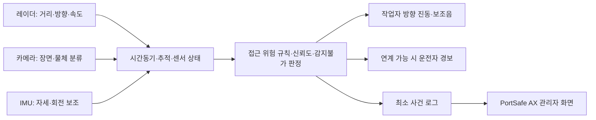

# PortSafe AX 착용형 카메라·레이더 위험경고 사전 타당성 검토

작성일: 2026-10-20. 사용자 답변: 적용 작업환경 아직 미정. 따라서 **지게차·야드 차량과 보행 작업자의 접근/충돌 위험 경고**를 우선 검증 가설로 설정한다. 특정 항만·운영사에 적용 결정한 것은 아니다.

## 1. 결론과 검증 수준

**개념 검증을 진행할 가치가 있다. 다만 “작업자 안전 확인 장치”보다 “정해진 조건에서의 주변 접근 위험 보조경고 장치”로 범위를 한정해야 한다.** 이번에 완료한 것은 공식자료·제조사자료 검토와 설계/시험계획이다. 장비 구매, 실제 센서 시험, 항만 실증, 안전성 인증, 사고 감소 검증은 수행하지 않았다.

- 국내 항만 안전조끼 착용 수칙은 확인했다. 부산항만공사 안전수칙은 안전모·안전화·안전조끼 착용 및 차량 하차 시 착용을 명시한다[S1]. 모든 항만의 실제 착용률이나 모든 직무에 동일한 법적 의무가 있다는 뜻은 아니다.
- 카메라는 물체 종류·장면 이해에, FMCW 레이더는 거리·방사방향 상대속도·방향 추정에 활용 가능하다[S3]. 결합해도 가림·오경보·지연이 없어지는 것은 아니다.
- 안전모는 카메라 기본 장착 위치로 확정하지 않는다. Petzl은 카메라 장착이 충격 흡수에 영향을 줄 수 있어 허용하지 않는다고 명시한다[S6]. 다른 제조사에도 같은 결론을 일괄 적용하지 말고 **정확한 안전모 모델과 장착구 조합**을 확인한다.
- 4면 레이더 조끼는 연구 후보로 유지한다. 1~2개 모듈에서 전력·몸 가림·금속 반사를 먼저 검증한 뒤 확대한다. 앞뒤2개는 시험용이며 전방위 보호 장치로 표시하지 않는다.
- 작업자 경보만으로 충돌 예방을 맡기지 않는다. 차량/보행자 분리·제한구역·기존 안전수칙을 유지하고, 가능하면 운전자에게도 경보하는 구조를 비교한다[S1,S2,S7].

## 2. 안전조끼 착용과 적용 환경

S1의 부산항10대 안전수칙에는 보호구 착용, 중장비 작업반경 접근금지, 지정 보행로 이용, 출입부두 운영사 안전수칙 준수가 함께 들어 있다. 따라서 조끼는 센서 장착 기반이 될 수 있지만 **경보가 없다는 이유로 중장비 작업반경에 들어갈 수 있게 하는 장치**로 설계하면 안 된다.

“안전조끼”는 고시인성/반사 의류와 구명조끼를 구분해야 한다. 수변 추락·익수 대응은 별도의 보호구·구조체계 검토 대상이다. 센서 부착으로 반사띠를 가리거나, 구명조끼 팽창·안전대·무전기·비상탈의 기능을 방해하면 안 된다. 작업별 실제 조끼 규격·착용방식·겨울 외투·우비와의 조합은 미확인이다.

또한 외향 카메라는 **착용자 본인의 조끼 착용 여부를 직접 확인하기 어렵다.** 본인 착용 확인이 필요하면 장착 상태/버클/착용센서 등 별도 수단을 검토하고, 단순 버클 닫힘을 올바른 착용의 증명으로 삼지 않는다. 출입구 카메라의 PPE 착용 검출과 착용형 주변 위험경고는 서로 다른 기능이다.

## 3. 대안 비교 — 아래 판단은 설계적 추론

|구조|기대 역할|주요 한계|사전 판단|
|---|---|---|---|
|조끼 앞 카메라1개|전방 차량/사람/작업 장면 분류|후방 안 보임, 팔·화물·굽힘으로 가림, 야간·역광·빗물·흔들림, 단안 거리오차|전방 상황 이해 보조로 검증|
|안전모 카메라1개|높은 시점, 머리가 향한 장면|머리와 몸 이동방향 불일치, 후방 사각, 무게·충격·걸림, 제조사 호환 문제|제조사 승인 전 보류|
|조끼 전후좌우 레이더4개|여러 방향의 거리·접근 추적|몸/팔 가림, 모서리 사각, 수직 사각, 금속 다중반사, 자기 움직임, 간섭·전력·배선|단계적 연구 후보|
|전방 카메라+전후 레이더+IMU|영상 의미·거리/속도·착용자 회전의 보완|측면 미감지, 시간동기·좌표 보정·센서 고장 복잡성|제한된 방향의 초기 실험안|
|차량 레이더/카메라+작업자 경보기|안정적인 장착, 차량 전원, 운전자 동시경보|차량 개조·승인·대수별 비용, 미장착 차량|유력 비교안|
|차량과 작업자 UWB 등 태그|등록된 작업자/차량 식별·거리 교환|태그 미착용, 비등록 차량/낙하물 미검출, 금속 비가시 경로 오차·인프라|폐쇄된 차량군이면 비교 실험|

비교 결과 하나를 현재 승자로 확정하지 않는다. 운행 차량이 통제되는 구역인지, 차량 설치가 가능한지, 작업자가 짐을 드는지에 따라 유리한 구성이 달라진다. UWB는 반사파로 비협조 물체를 검출하는 레이더와 다른 방식이다.

## 4. 감지 범위: 가능한 가설과 제외할 주장

|위험|검토할 기술|한계와 추가조건|
|---|---|---|
|지게차/야드 차량 접근|레이더 추적+영상 분류+지역별 운행정보|실제 상대경로·차량 외곽·경보 여유시간 시험 필요|
|고정 장애물/컨테이너 모서리|영상 또는 정적 표적을 유지하는 레이더 처리|정지 반사 제거 알고리즘이 장애물까지 지울 수 있음|
|협착·차량 선회 후미|차량 측 감지+차체 경계/선회 영역 모델|물체 중심까지 거리만으로는 판정 부족|
|가려진 차량|차량 태그/고정 인프라와 연계 검토|금속 컨테이너 너머를 조끼 센서가 항상 볼 수 있다고 주장 금지|
|상부 낙하물/매달린 하중|전용 상향 감지·크레인 작업구역 관리 별도 검토|몸통4면 수평 센서로 상부 보호 보장 불가|
|안벽 끝/추락/익수|구역 경계·위치·전용 센서/구조체계 별도 검토|전방 레이더에서 물체가 안 보이는 것이 바닥 안전을 뜻하지 않음|
|피로·열질환·근골격 부담|별도 생리/작업 데이터와 검증 필요|외향 레이더로 착용자 건강 안전을 직접 확인하지 못함|

## 5. 레이더4개 설계의 핵심 난점

1. **유효 시야각:** 부품의 공칭 FOV 합계가360도라고 실제360도 검출이 되는 것은 아니다. 팔·공구·하네스·신체·조끼 주름과 모듈 기울기를 포함한 각도별 검출지도를 만든다. 센서 사이 겹침 영역과 상하 방향도 측정한다.
2. **금속 다중반사:** 컨테이너·차체·벽 반사로 가짜 표적이 나타날 수 있다. TI도 금속 주변 다중반사 및 임계값을 높이면 진짜 약한 표적을 놓칠 수 있는 절충을 설명한다[S4].
3. **자기 움직임:** 걷기·몸 회전·팔 흔들림이 관측 속도와 방향을 바꾼다. IMU와 추적으로 보정하되 IMU만으로 정확한 이동속도/절대위치가 확보된다고 가정하지 않는다. 필요하면 영상 움직임/외부 기준과 비교한다.
4. **속도 해석:** 레이더 도플러는 주로 방사방향 속도다. 옆에서 교차하는 물체는 위험해도 순간 방사속도가 작을 수 있다. 단순 거리/접근속도만으로 모든 충돌을 판단하지 않는다.
5. **간섭:** 본인4개 센서뿐 아니라 주변 작업자·차량의 레이더까지 영향을 줄 수 있다. TI는 간섭으로 미검출·사각·허상이 생길 수 있다고 설명한다[S5]. 시간분할·파형 설계·간섭 진단을 시험하되 시간분할의 갱신 지연도 측정한다.
6. **환경:** 어둠에 강하다는 특성을 비·염분·젖은 커버·분진·진동에도 성능 보장된다는 주장으로 확대하지 않는다. 안테나 커버 재질/두께/오염, 방수·세척 후 성능을 직접 시험한다.
7. **소형 부품과 제품은 다름:** 모듈 외에 배터리·처리부·안테나 커버·배선·방수구조·진동모터가 필요하다. 칩의 저전력 수치를4면 연속 추적 시스템 소비전력으로 사용하지 않는다.

## 6. 권장 시험 구조

**핵심 경보는 로컬에서 처리**하고 네트워크/클라우드 연결이 끊겨도 설계 범위 내 경보가 동작하도록 한다. 센서 고장·가림·과열·배터리 부족은 위험 미검출과 구분된 “감지 제한/고장” 상태로 알린다. 센서 융합은 무조건 둘 다 감지해야 경보하는 AND 조건으로 만들지 않는다. 한 센서 고장이 다른 센서의 유효한 위험 경고까지 막을 수 있기 때문이다. 반대로 무조건 OR로 합쳐 오경보를 증가시키지 않도록 위험유형별 정책을 검증한다.

사용자 경고는 화면 응시 대신 몸 기준 앞/뒤/좌/우 진동을 우선 실험한다. 진동 위치가 “위험이 오는 방향”이라는 뜻인지 교육·인지 시험으로 확인한다. 회피 방향은 다른 위험을 만들 수 있으므로 단순히 “오른쪽으로 피하라”고 지시하지 않는다. 소음·귀마개 환경에서 음향만 의존하지 않는다. 위험신호와 장치고장 신호는 구별한다.

카메라 물체분류가 학습모델이면 해당 부분만 AI로 표기한다. 거리 임계값·추적·충돌경고 규칙과 현장 안전 효과는 별도로 검증한다. 범용 사전학습 모델을 탑재했다고 항만에서 검증된 AI가 되는 것은 아니다.

## 7. 경고 거리·지연과 전력 산정 예시

아래 수치는 구매 규격이나 안전 기준이 아니라 **시험 설계를 위한 산술 예시**다.

- 움직이는 차량 기준 정지 여유거리의 단순 예: `d = v×(감지/통신 지연+운전자 반응시간) + v²/(2a) + 여유거리`.
- v=10km/h=2.78m/s, 지연0.3초, 반응1.5초, 감속도1m/s², 여유2m를 가정하면 약10.9m다. 즉 “2~3m에서 울리는 근접 센서”만으로 충분하다고 판단할 수 없다. 노면·적재·차종·상대 보행·경사·운전자 반응에 따라 다시 계산하고 시험해야 한다. 자동제동이나 실제 안전거리 확정식으로 사용하지 않는다.
- `TTC≈거리/접근속도`는 같은 선상에서 일정 속도로 접근하는 단순 조건의 보조지표다. 교차·선회·가감속·차체 외곽에는 경로와 최소 예상 이격거리 검토가 필요하다.
- 평균소비전력 가정이8W이고8시간 운용, 가용에너지 비율0.8이면 명목 배터리 에너지 `8×8/0.8=80Wh`. 실제8W라고 측정한 것이 아니다. 소비전력·저온·노화·출력/경보 빈도를 실측해야 한다. 큰 배터리가 필요하면 조끼 전자장치 구성을 줄이거나 차량 설치형으로 전환한다.
- 도입비는 부품가격만이 아니라 전용 PCB·기구·배터리·인증·현장 검증·세척/충전·교체·운영교육 비용까지 산정한다. 부품 미선정이므로 현재 단가/총예산은 확정하지 않는다.

## 8. 개인정보·보호구·전파·현장 승인 검토

|영역|결정 전에 확인할 것|현재 상태|
|---|---|---|
|안전모/조끼|해당 모델 제조사의 부착 허용, 충격·걸림·반사면·탈의 영향|모델 미정. 임의 천공/접착/카메라 장착 승인 없음|
|영상|적법한 처리 근거, 촬영 표시, 근로자·방문객 권리, 보관/접근/삭제, 항만 보안|개인정보위 안내서 존재와 기본 원칙 확인[S8]. 해당 현장 적용 판단 미완료|
|영상 최소화|기본 영상 저장 없이 로컬 처리, 음성 수집 끔, 사건 메타데이터 우선|설계 권고. 저장하지 않아도 영상 처리의 적법성 검토는 필요|
|위치/태그|작업자ID·이동이력과 연결 시 개인정보 및 감시 우려|생산성 평가/징계용 전용 금지 정책 제안, 노사 협의 필요|
|전파|60/77GHz 등 대역별 국내 용도·출력·실내외·장착조건, 적합성평가·EMC·인체노출 검토|TI 주파수 자료는 국내 허가 증명이 아님[S9]. RRA/시험기관에 최종 사양으로 확인[S10]|
|배터리/환경|충격·발열·방수/염수·충전, 배터리 적합성, 위험물 구역 방폭 필요 여부|환경·제품 미정. IP/방폭/안전등급 주장 금지|
|안전 기능|부품 수준 인증과 완제품·알고리즘·사용방식의 검증 구분|자동정지 기능 미제안. 경보가 기존 안전조치를 대체하지 않음|

현재 자료만으로 특정 국내 법 조항 위반/적합, 필요한 인증 종류, 사용가능 주파수를 확정하지 않는다. 실증 장소와 제품 사양이 정해진 뒤 운영사·보호구 제조사·전파/안전 시험기관의 확인이 필요하다. 관련 기관에 연락하거나 승인을 받은 상태는 아니다.

## 9. 전체 검증 계획과 중단 조건

### 단계0 — 현장 범위 확정

작업자·운전자·안전관리자 각 역할 인터뷰, 차량 종류/속도·보행동선·컨테이너 가림·조끼 종류·교대시간·소음·우천 작업 여부·촬영 제한 조사. 위험분석표에 어떤 상황을 감지할 것인지/못하는지 명시한다. 초기 목표는 “저속 차량의 지정 접근 상황에서 경고 여유 확보”로 제한한다.

### 단계1 — 탁상/실험실 모듈 시험

레이더1개와 카메라를 각각 시험해 거리/각도/속도·프레임 지연·전력 측정. 금속벽·정지 물체·횡단 표적·센서 흔들림·카메라 가림을 기록한다. 영상 정답과 독립 거리/속도 기준을 확보한다. 센서1개를 통과하지 못하면4개 통합으로 넘어가지 않는다.

### 단계2 — 인체 모형/통제된 시험장

사람을 이동차량 충돌 경로에 세우지 않고 마네킹·이동 표적과 물리적 분리로 접근/교차를 재현한다. 전후2개→4개 순으로 확장하여 동일 조건 비교. 훈련된 시험 책임자·차량 정지수단·통제구역을 갖춘다. 근접사고를 일부러 만들지 않는다.

|시험군|반드시 포함할 조건|수집 지표|
|---|---|---|
|기하/가림|앞·뒤·양옆·대각, 팔 내림/들기, 화물 운반, 굽힘/회전, 큰/작은 체형|각도별 최초검출 거리·누락·유효 시야|
|운동|정면 접근·후진·횡단·평행 통과·회전·정지 장애물, 작업자/센서 이동|실제 위협별 검출률, 비위협 경고, 경고 여유시간|
|환경|주간·야간·역광·조명 점멸·우천/렌즈 물방울·금속 통로·먼지|조건별 미검출/오경보·영상/레이더 저하|
|밀집/간섭|작업자1/여러 명, 다수 차량, 여러 레이더 동시운용|트랙 혼동·간섭·지연·고스트|
|고장|센서 가림/연결 해제·프로세스 정지·통신 단절·저전압·과열|고장 인지 시간, 감지제한 표시, 로컬 경보 유지 여부|
|착용성|짧은 착용→장시간, 우비/외투/안전대/구명조끼 조합|총중량·발열·걸림·불편·경고방향 인지·작업 방해|

### 단계3 — 현장 병행 관찰

실험실 통과 후 현장 허가 하에 **기존 안전관리 유지·판단에 비개입** 상태로 데이터를 모은다. 관측 경고를 실제 사건과 대조하고 업무별 오경보를 조정한다. 근로자에게 보호가 보장된다는 인상을 주지 않는다. 이후 승인된 한정 시범만 진행한다.

### 초기 인수 기준 초안 — 현장 합의 전 연구 목표

- 위험 사건 단위로 검출/미검출/늦은 경고를 구분한다. 영상 프레임 수를 표본 수처럼 부풀리지 않는다.
- 중요한 각 조건에서 **늦은 경고 또는 미검출이 발생하면 그 조건의 적용을 중단**하고 원인 수정·재시험. “안전하다”는 종합 평균으로 덮지 않는다.
- 검출률 목표 예99%와 오경보 목표 예 작업자당1회/시간 이하를 검토할 수 있으나 법정·현장 수용 기준은 아니며 위험분석·작업자 평가로 확정한다.
- 300회의 독립·대표성 있는 동일 조건 시험에서 미검출0회여도 실패확률이0이 아니다. 이항모형 단측95% 상한은 약1%다. 서로 다른 쉬운 조건을 합쳐 어려운 조건의 성능을 보장하지 않는다.
- 시스템 지연의 평균뿐 아니라95/99백분위·최댓값과 고장시 상태를 기록한다. 예0.3초는 잠정 지연 예산이며 실제 경고 여유거리로 적절성을 판정한다.
- 배터리는 실제 교대시간+현장 합의 예비시간 동안 연속 동작해야 한다. 저전압 경고·재시작·충전 누락·세척 후 성능을 시험한다.
- 중량·발열·경고 인지 기준은 착용자 평가와 제품 안전 검토로 정한다. 숫자를 임의로 인증 기준이라고 부르지 않는다.
- 보호구 기능 저하, 해결되지 않는 고장 미표시, 필수 방향 상시 사각, 잦은 경보로 무시/해제, 전력/중량 과다 중 하나라도 해결 안 되면 차량 설치형 또는 적용범위 축소로 전환한다.

## 10. PortSafe AX와 공모전 반영

기존 A 작업부담·B 제약 재배치·C 대시보드·E 시뮬레이션·F 시연은 유지한다. 새 개념은 **주변 접근 경고 연구 모듈**로 구분한다. 기존 D SafeBack IMU·인솔은 여전히 후속 확장이며, 주변 물체 검출용 센서와 근골격 부담 센서를 혼동하지 않는다.

연계 데이터 계약 제안: `event_id, timestamp, sensor_origin(SIMULATED/DEVICE), direction, distance_m, radial_speed_mps, object_class, confidence, sensor_health, alert_level, acknowledged, firmware_version`. 모든 값에 단위·결측·시간동기 상태를 둔다. 합성 사건은 장비 검출 실적으로 합산하지 않는다. 센서 신뢰도가 낮으면 “안전” 대신 “판단 불가/감지 제한”.

실시간 경보는 착용/차량 장치에서 수행하고, C에는 구역별 사건·장치고장·관리자 확인 현황을 올린다. A의 신체부담 점수에 접근경보 횟수를 임의 가중합하지 않는다. B 재배치는 관리자 검토를 거쳐 작업 환경을 개선하는 연결만 검토하고, 검출되지 않은 위험을 없다고 취급하지 않는다.

10/30 공모전까지 권장 범위: 원리/한계/검증계획과 합성 접근 사건을 보여주는 시연. 실제 장비를 확보하지 못하면 “레이더 실측·360도 감지·충돌 방지 검증”을 주장하지 않는다. 영상 기반 AI를 추가하더라도 실제 모델 실행과 사전제작 애니메이션을 명확히 구분한다. 하드웨어 검증 완료를10일 안에 약속하지 않는다.

다음 실행 순서: ① 작업환경/실증 파트너와 보호구 모델 확인 → ② 차량형/조끼형 요구 비교 → ③ 국내 사용 조건에 맞는 모듈 후보·시험장비·견적 확보 → ④ 모듈1개 성능 시험 → ⑤ 통제 시험·착용 평가 → ⑥ 제한 현장 관찰. 현재는① 이전의 사전 타당성 검토 완료 상태다.

## 11. 근거 자료

확인일2026-10-20. 제조사 자료는 기술 가능성과 한계를 설명하며 완제품의 항만 안전성 증거가 아니다. 해외 건설/광산 연구도 항만 직접 실증과 구분한다.

- **S1 부산항만공사, 부산항10대 안전수칙:** https://www.busanpa.com/board/view.bpa?boardId=BBS_0000023&dataSid=25542&menuCd=DOM_000000104002005000&paging=ok&startPage=4
- **S2 HSE, Safety in docks:** https://www.hse.gov.uk/pubns/priced/l148.pdf — 항만 차량/보행자·후진·시야 위험과 동선 분리.
- **S3 TI, mmWave Radar Sensing and Sensor Fusion in Humanoid Robots:** https://www.ti.com/document-viewer/lit/html/SWRA831A/GUID-DCB37E5E-815E-4868-ABDC-EFD0D662A6D5 — 센서별 특성과 융합. 로봇 적용자료이며 착용형 항만 검증 아님.
- **S4 TI, Mirrored Ghosts 제조사 답변:** https://e2e.ti.com/support/sensors-group/sensors/f/sensors-forum/731897/linux-iwr1443boost-mirrored-ghosts — 다중반사와 검출 임계값 절충.
- **S5 TI, Interference Mitigation for AWR/IWR Devices:** https://www.ti.com/lit/an/swra662/swra662.pdf — 레이더 간 간섭·미검출·허상.
- **S6 Petzl, Can I mount a camera, like a GoPro, on my helmet?:** https://www.petzl.com/DE/en/Professional/FAQ/Can-I-mount-a-camera-like-a-GoPro-on-my-helmet — 카메라 장착 불허. 다른 안전모 모델의 판단은 해당 제조사 확인 필요.
- **S7 NIOSH, Recommendations for Evaluating & Implementing Proximity Warning Systems on Surface Mining Equipment:** https://stacks.cdc.gov/view/cdc/8494 — 차량 센서/영상/태그 평가, 광산 맥락.
- **S8 개인정보보호위원회, 이동형 영상정보처리기기 안내서 공개:** https://pipc.go.kr/np/cop/bbs/selectBoardArticle.do?bbsId=BS212&mCode=C040030000&nttId=10689 — 촬영 표시·적법성·최소화·처리단계별 보호 원칙.
- **S9 TI Radar Academy, Frequency Choice and Regulations:** https://dev.ti.com/tirex/explore/content/radar_academy_2_10_00_2/_build_radar_academy_2_10_00_2/source/device_selection/regulations.html
- **S10 국립전파연구원 적합성평가 제도DB:** https://www.rra.go.kr/ko/notice/licenseList.do?cpage=1 — 확인 창구. 특정 모듈 적합성 확인 완료를 뜻하지 않음.
- **S11 NIOSH, Wearable Technologies for Improved Safety and Health on Construction Sites:** https://www.cdc.gov/niosh/bulletin/2019/wearable-construction.html — 착용형·차량형 접근경고 연구 배경. 건설 현장 자료.
